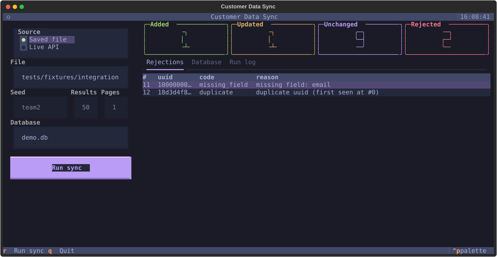

# Customer Data Sync Tool

A customer keeps contact records in an external system and needs them copied into a local database every day. The data arrives messy and the connection sometimes fails, so a manual re-run is not a reliable process.

This command-line tool pulls customer records from the Random User API, cleans and validates them, stores the valid ones in a local SQLite database, and prints a sync summary: records **added**, **updated**, **unchanged**, and **rejected**. Re-running a sync updates existing rows by `uuid` and does not create duplicates.

```
API Client -> Cleaning/Validation -> SQLite Storage -> CLI summary
(fetch, (Customer class, (upsert, counts) (--from-file,
 retries) reject bad records) integration)
```

`--from-file` replaces the API client with a saved response file, so demos and tests need no network.

## Install

Requires Python 3.11 or newer.

```bash
python -m venv .venv
```

Activate the virtual environment, then install the tool and its dev tools:

```bash
# macOS and Linux
source .venv/bin/activate

# Windows
.venv\Scripts\activate

pip install -e ".[dev]"
```

That installs the `customer-sync` command.

## Usage

Live API (default `seed=team2`, `results=50`, `pages=1`):

```bash
customer-sync
```

That calls `https://randomuser.me/api/1.4/?seed=team2&results=50&page=1` and writes `customers.db` in the current directory.

Saved response, no network:

```bash
customer-sync --from-file tests/fixtures/integration/day1.json --db demo.db
```

`day1.json` is a saved API response (`{"results": [...]}`). Into an empty database it adds 10 records and rejects 2.

```
customer-sync [--from-file PATH] [--db PATH=customers.db] [--seed team2] [--results 50] [--pages 1] [--quiet-rejections]
```

| Flag | Default | Meaning |
|---|---|---|
| `--from-file PATH` | live API | Read a saved Random User response instead of calling the API |
| `--db PATH` | `customers.db` | SQLite database file |
| `--seed` | `team2` | API seed (ignored with `--from-file`) |
| `--results` | `50` | Records per API page (ignored with `--from-file`) |
| `--pages` | `1` | Number of API pages (ignored with `--from-file`) |
| `--quiet-rejections` | off | Print the four counts and hide the per-record rejection lines |

### Exit codes

| Code | When |
|---|---|
| `0` | The sync finished. Rejected records still exit `0`; they are counted in the summary. |
| `1` | A `SyncError`: the API failed after retries (`ApiError`), `--from-file` is missing or the wrong shape (`SourceFileError`), or the database could not be read or written (`StorageError`). |
| `2` | Bad usage (unknown flag or a non-integer `--results` / `--pages`). |

A failed sync leaves the database unchanged. The next run can catch up.

### Sample summary

```
Sync complete (source: file tests/fixtures/integration/day1.json, db: demo.db)
  added:      10
  updated:     0
  unchanged:   0
  rejected:    2
Rejected records:
  #10  uuid=10000000…  missing_field  missing field: email
  #11  uuid=18d3d4f8…  duplicate  duplicate uuid (first seen at #0)
```

An API run prints `source: api seed=<seed>`. A shown uuid is the first 8 characters plus `…`. If the record had no uuid, the line says `uuid=Missing`.

## Terminal UI

An optional full-screen view of the same sync. It uses the same source, cleaner and database code as the CLI, so a run gives the same counts.

```bash
pip install -e ".[tui]"
customer-sync-tui
```

Pick **Saved file** or **Live API** on the left, set the database path, and press **Run sync** (or `r`). The four counts appear as large numbers. The tabs show the rejected records with reasons, every stored customer, and a log of each run. `Ctrl+P` switches the colour theme, and `q` quits. Run it from the repository root so the default file path `tests/fixtures/integration/day1.json` resolves.



## Customer record schema

Clean records match `Customer` in `src/customer_sync/contracts.py`. Safe normalisation only: trim, lowercase the email, and turn a numeric phone into text. Anything else is rejected. A missing value is never invented.

| Field | Type | Nullable | Source (API) | Cleaning rule |
|---|---|---|---|---|
| `uuid` | `str` | no | `login.uuid` | strip, lowercase, must parse as UUID |
| `first_name` | `str` | no | `name.first` | strip, non-empty |
| `last_name` | `str` | no | `name.last` | strip, non-empty |
| `email` | `str` | no | `email` | strip, lowercase, `^[^@\s]+@[^@\s]+\.[^@\s]+$` |
| `phone` | `str \| None` | yes | `phone` | strip; int → str; empty → `None` |
| `city` | `str \| None` | yes | `location.city` | strip; empty → `None` |
| `country` | `str \| None` | yes | `location.country` | strip; empty → `None` |
| `registered_at` | `str` | no | `registered.date` | parse ISO 8601, emit UTC `YYYY-MM-DDTHH:MM:SSZ` |

### Unique identifier

The unique identifier is `login.uuid`. It is system-generated and does not change when a customer updates their contact details, so an email change is an **update** of the same row. Email is a poor key: it changes, and two people can share one. Email is still validated, and a repeated email under a different uuid in the **same batch** is rejected. The first occurrence is kept.

Known limitation: two different uuids with the same email in **separate** runs are both stored.

### Rejection reasons

Every rejected record has a code and a reason.

| Code | When |
|---|---|
| `missing_field` | A required field is missing |
| `wrong_type` | A value has the wrong type and cannot be coerced safely |
| `invalid_value` | The format is bad (uuid, email, or `registered_at`) |
| `duplicate` | The same `uuid` appears again in the batch, or the same email appears under a different uuid. The first occurrence is kept. |

## Scheduling nightly

Run the tool once a night. A non-zero exit means the job failed and should alert. Exit `0` with a non-zero `rejected` count means the sync stored the valid rows and listed the bad ones; alert on that only if you want a human to look at the rejections.

Cron, 02:00 every day:

```cron
0 2 * * * cd /path && .venv/bin/customer-sync --db /data/customers.db >> sync.log 2>&1
```

Replace `/path` with the directory that contains `.venv`.

On Windows, use Task Scheduler. Create a daily task whose program is `.venv\Scripts\customer-sync.exe`, whose "Start in" directory is the repository, and whose arguments are `--db C:\data\customers.db`. Send stdout and stderr to a log file. Treat a non-zero exit code as a failure and alert on it.

If the API is down, the client retries, then exits `1` and leaves the database unchanged. The next night's run picks up the same records.

## Development

Tests run offline. They use saved API responses and temporary databases. `pytest` blocks network sockets.

Before you push:

```bash
./scripts/check.sh
```

That runs Ruff, the format check, mypy, and pytest.

Branch from a fresh `main` as `<first-name>/<area>-<topic>`. One board task per pull request. Commit messages look like `docs(docs): describe install and nightly sync`. The full branch, commit, and review rules are in [PLAN.md](PLAN.md) §6.

| Module | Owner | Notes |
|---|---|---|
| API client | Vedant Misra | [docs/api-client.md](docs/api-client.md) |
| Cleaning and validation | Julian Marchington | [docs/cleaning.md](docs/cleaning.md) |
| SQLite storage | Nikita Ravi | [docs/storage.md](docs/storage.md) |
| CLI, CI, and this README | Ansh Harjai | [docs/cli.md](docs/cli.md) |
